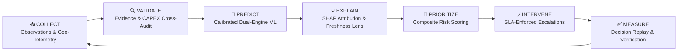
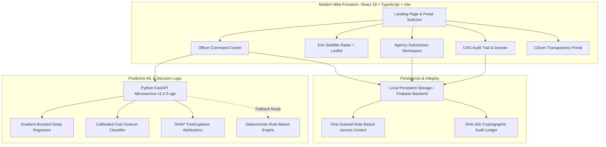

<div align="center">

# 🇮🇳 ProjectSetu — Integrated Infrastructure Intelligence
### AI-Powered Predictive Monitoring, High-Res Satellite Geospatial Radar & Automated Intervention Platform
**Smart India Hackathon (SIH26103) • Ministry of Statistics & Programme Implementation (MoSPI) • IPMD**

[](https://projectsetu.vercel.app)
[](https://github.com/codexanjan/projectsetu)
[](LICENSE)

<br/>

[](https://react.dev/)
[](https://vitejs.dev/)
[](https://tailwindcss.com/)
[](https://leafletjs.com/)
[](https://fastapi.tiangolo.com/)
[](https://github.com/codexanjan/projectsetu/actions)

<p align="center">
  <b>Transforming India's ₹100+ Lakh Crore National Infrastructure Pipeline (NIP) & PM Gati Shakti into a predictive, transparent, and accountable delivery ecosystem.</b>
</p>

[🌐 Live Web Platform](https://projectsetu.vercel.app) • [🛰️ Satellite Radar View](https://projectsetu.vercel.app/app) • [🏛️ Citizen Portal](https://projectsetu.vercel.app/public) • [📖 Documentation](#-system-architecture) • [⚡ Quickstart](#-quickstart--local-development)

---

</div>

## 📌 Executive Summary

India's mega infrastructure investments—spanning highways (NHAI), railways (RVNL), metros, bulk water pipelines, and power evacuation corridors—frequently encounter substantial schedule slippages and cost overruns. Traditional oversight relies on static PDF submissions, disjointed inter-agency communications, outdated milestone baselines, and post-facto audit postmortems.

**ProjectSetu** reimagines national project governance by implementing a continuous, closed-loop intelligence cycle:



---

## 🌟 Key Innovations & Differentiators

| Innovation | Operational Impact | Governance Benefit |
| :--- | :--- | :--- |
| **🛰️ Exclusive High-Res Satellite Radar** | Real-time orbital imagery via Esri Multispectral tiles paired with dark-line infrastructure corridors and anti-overlap smart telemetry pins. | Eliminates reliance on watermarked map services; provides instant ground-truth spatial context. |
| **🛡️ Cryptographic Risk Passport** | Generates an immutable, SHA-256 fingerprint snapshot recording input features, model version (`v1.2.0-xgb`), policy weights, and officer determinations. | Guarantees non-repudiation; allows officers to inspect past reviews without dynamic recomputation. |
| **⏱️ Freshness & Evidence Lens** | Decouples data currency (e.g. 45-day reporting lag) from intrinsic structural engineering risks. | Prevents false alarms on physically sound projects while highlighting delinquent reporting agencies. |
| **⏪ Decision Replay Narrative** | Reconstructs the 5-step institutional memory: *Observation → AI Prediction → Officer Deliberation → Assigned Escalation → Verified Outcome*. | Comprehensive institutional accountability for Parliamentary Committees and CAG audits. |
| **🕸️ Dependency Cascade Graph** | Graph-traversal engine mapping critical prerequisite chains: *Land Acquisition → Forest Clearance → Utility Shifting → Civil Construction → Grid Sync*. | Early warning indicator for downstream bottlenecks before execution begins. |
| **🎛️ What-If Scenario Sandbox** | Real-time recovery simulation allowing officers to evaluate contractor augmentation, fund injections, and fast-track statutory clearances. | Quantifies expected risk reduction delta before capital allocation. |
| **👥 Cross-Portal Interconnection & Simulation** | Live interconnected portals for MoSPI Officers, Line Agencies, CAG Auditors, Field Contributors, and Citizens with real-time sync. | Multi-stakeholder coordination with built-in action simulation workflows. |

---

## 🖥️ Platform Screens & Feature Walkthrough

### 1. 🛰️ National Satellite Geospatial Radar (`/app`)
- **Orbital Multispectral Terrain:** Powered by Esri World Imagery with zero API key dependencies and zero watermarks.
- **Dark Infrastructure Corridors:** High-contrast obsidian outlines (`#020617`, weight 8) with dynamic cyan radar cores showing India's critical transit spines (Delhi-Katra Expressway, Western DFC, Eastern DFC, North-South Spine, and Saurashtra Coastal Pipeline).
- **Anti-Overlap Smart Pins:** Responsive markers adapt smoothly between zoom levels—sleek 28px circular target pins at national zoom to prevent badge collision, expanding into rich telemetry cards with `#proj-code`, budget in ₹ Cr, and risk rating on hover or selection.
- **Right Telemetry Drawer:** Instant access to delay forecasts, physical vs. financial progress gaps, contractor rating, and direct drilldown links.

### 2. 🏛️ MoSPI National Portfolio Command Center (`/app`)
- **Key Metrics Overview:** Total Capital Outlay, Overrun Exposure, Milestone Slippages, and National Average Health Index.
- **Multi-Dimensional Filtering:** Slice portfolio across ministries (MoRTH, Railways, Power, MoHUA, Jal Shakti), states, risk categories, and physical progress bands.
- **Dual Perspective:** Seamless 1-click toggle between Geospatial Satellite Radar and High-Density Tabular Data Grid.

### 3. 🔍 Explainable AI & Project Dossier (`/app/projects/:id`)
- **Baseline Revisions:** Track original vs. current sanctioned outlay with cost escalation percentages and authorized revision justifications.
- **SHAP Feature Attributions:** Transparent top-5 delay drivers (e.g., *Inter-tidal Marine Piling Constraints*, *Land Acquisition Delays*, *Material Cost Inflation*).
- **Evidence Verification Queue:** Cross-audit comparing physical execution against cumulative financial disbursements to detect anomalous billing.
- **Printable Dossier:** One-click generation of the official MoSPI Project Monitoring Dossier ready for review meetings.

### 4. ⚡ Inter-Agency Escalation & Intervention Matrix (`/app/interventions`)
- **Multi-Tier Escalation:** Rule-based routing to District Magistrates, State Chief Secretaries, Railway Boards, or Cabinet Committees.
- **SLA Enforcement:** Target resolution dates with automatic overdue warnings and escalation triggers.
- **Evidence-Backed Closure:** Line agencies must submit geotagged photos or formal statutory clearances before an officer can mark an intervention verified.

### 5. 🏗️ Contractor 360 Evaluation (`/app/contractors`)
- **Performance Rating Index:** Composite rating (1.0 to 5.0) evaluated across on-time delivery, cost adherence, safety compliance, and dispute history.
- **Active Exposure Analysis:** Real-time visibility into contractor workload across multiple simultaneous national projects to detect bandwidth strain.

### 6. 🌐 Public Transparency & Citizen Grievance Portal (`/public`)
- **Open Governance:** Unauthenticated public access to whitelisted project summaries, physical progress meters, and geotagged project locations.
- **Citizen Feedback & Grievance Lodging:** Citizens can submit geo-localized observations or concerns directly to MoSPI with automated tracking tokens.

---

## 🏗️ System Architecture



---

## 🧠 Machine Learning Engine (`v1.2.0-xgb`)

### 1. Leakage-Free Temporal Group Strategy
- **Synthetic Training Corpus:** 200 diverse infrastructure projects across 5 sectors (Highways, Rail, Metro, Energy, Water) generating 4,741 longitudinal monthly observations.
- **Strict Group Splitting:** Grouped by `project_id` (80% Train, 20% Test) to ensure no temporal leakage occurs between training features and test outcomes.

### 2. Dual Predictive Targets
1. **Cost Overrun Classifier:** Calibrated probability $C \in [0, 1]$ of completed expenditure exceeding the baseline by $\ge 10\%$.
   - **ROC-AUC:** `0.8037` • **PR-AUC:** `0.8172` • **Brier Score:** `0.1420`
2. **Schedule Delay Regressor:** Predicts positive slippage in days $S \in [0, \infty)$ beyond the contractual completion date.
   - **MAE:** `158.8 days` • **Median AE:** `122.5 days` • **80% Prediction Interval**

### 3. MoSPI Composite Risk Score Formula
$$\text{RiskScore} = \text{round}\Big(100 \times \big(0.40\,C + 0.30\,S_{\text{norm}} + 0.20\,M + 0.10\,B\big)\Big)$$

Where:
- $C$ = Calibrated Cost Overrun Probability
- $S_{\text{norm}} = \text{clamp}\left(\frac{\text{Predicted Delay Days}}{\max(90,\, 0.25 \times \text{Original Duration Days})},\, 0,\, 1\right)$
- $M$ = Milestone Slippage Ratio
- $B$ = Review Blocker Severity Index

---

## 💻 Tech Stack & Languages

<div align="center">

| Layer | Technologies |
| :--- | :--- |
| **Frontend Framework** | **React 18**, **TypeScript 5.3**, **Vite 6** (Blazing Fast HMR & Tree-Shaking) |
| **Styling & Motion** | **Tailwind CSS 3.4**, **Lucide Icons**, **GSAP Motion**, **Framer Motion** |
| **Geospatial & Mapping** | **Leaflet 1.9**, **Esri World Imagery**, **ArcGIS REST Services**, **SVG Vector Overlays** |
| **State & Data Store** | **React Hooks**, **Modular Context**, **IndexedDB / LocalStorage**, **Firebase Cloud Firestore** |
| **Predictive Backend** | **Python 3.11**, **FastAPI**, **scikit-learn**, **XGBoost**, **SHAP**, **Uvicorn** |
| **DevOps & Hosting** | **Vercel Edge Network**, **GitHub Actions CI/CD**, **Docker**, **Monorepo Workspaces** |

</div>

---

## ⚡ Quickstart & Local Development

### Prerequisites
- **Node.js** v18+ or v20+ / **npm** v10+
- **Python** 3.10+ (Optional, for training/running ML microservice)
- **Git**

### 1. Clone the Repository
```bash
git clone https://github.com/codexanjan/projectsetu.git
cd projectsetu
```

### 2. Install Monorepo Dependencies
```bash
npm install
```

### 3. Launch the Web Platform
```bash
cd apps/web
npm run dev
```
Open **[http://localhost:5173](http://localhost:5173)** in your browser.

### 4. (Optional) Run the Python ML Microservice
```bash
cd services/ml
python -m venv venv
# Windows:
venv\Scripts\activate
# macOS/Linux:
source venv/bin/activate

pip install -r requirements.txt
python -m uvicorn app.main:app --port 8000 --reload
```
Interactive API Docs available at: `http://localhost:8000/docs`

### 5. Build for Production
```bash
cd apps/web
npm run build
```

---

## 🎯 Smart India Hackathon Demonstration Walkthrough

1. **Landing Page (`/`):** View the mission statement, live satellite radar preview, and portal selection cards.
2. **Interactive Role Switcher (`/app`):** Instant 1-click switching between **MoSPI Officer**, **Agency Manager**, **CAG Auditor**, and **Field Contributor**.
3. **Satellite Radar (`/app`):** Explore India's 5 major multi-modal transit corridors and click pins to inspect live telemetry.
4. **Project Deep Dive (`/app/projects/proj-nhai-001`):** Inspect the **Risk Passport**, **Baseline Comparison**, **SHAP Drivers**, and **Scenario Workspace**.
5. **Contractor Analysis (`/app/contractors`):** Review performance scores, ongoing commitments, and delivery speed across agencies.
6. **Citizen Portal (`/public`):** Test public-facing transparency with unauthenticated access.

---

## 🏷️ Keywords & Hashtags

`#SmartIndiaHackathon` `#SIH2024` `#SIH26103` `#MoSPI` `#PMGatiShakti` `#NationalInfrastructurePipeline` `#GeospatialAI` `#SatelliteImagery` `#MachineLearning` `#ExplainableAI` `#XGBoost` `#ReactJS` `#TypeScript` `#Vite` `#TailwindCSS` `#Leaflet` `#PublicProcurement` `#InfrastructureMonitoring` `#GovTech` `#DigitalIndia`

---

## 📄 License & Ethical Disclosures

This project is open-source software licensed under the **[Apache License 2.0](LICENSE)**.

> **Statutory Disclaimer:** ProjectSetu is an AI-assisted decision-support prototype engineered for the Smart India Hackathon (SIH26103). Project records, financial figures, contractor evaluations, and risk classifications represented in demonstration datasets are synthetic and designed for educational and analytical purposes.

---

<div align="center">
  <b>Built with ❤️ for Digital India & Smart India Hackathon 2024</b><br/>
  <sub>Ministry of Statistics and Programme Implementation (MoSPI) • Infrastructure and Project Monitoring Division (IPMD)</sub>
</div>
